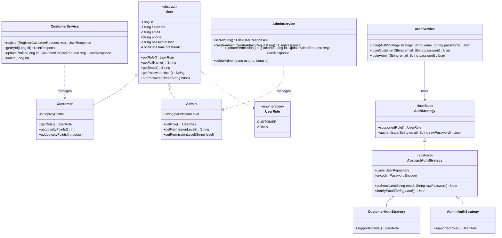
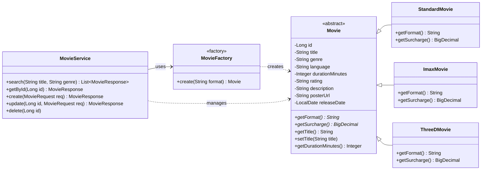
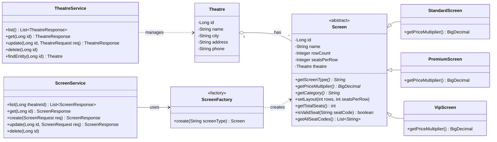
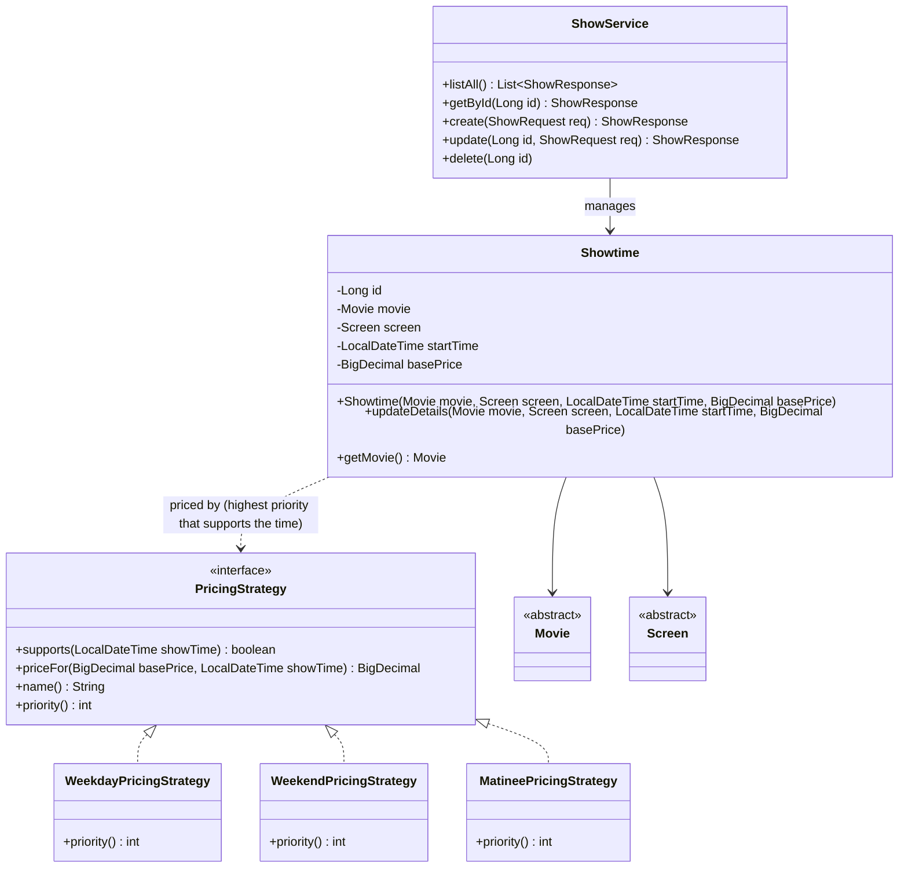
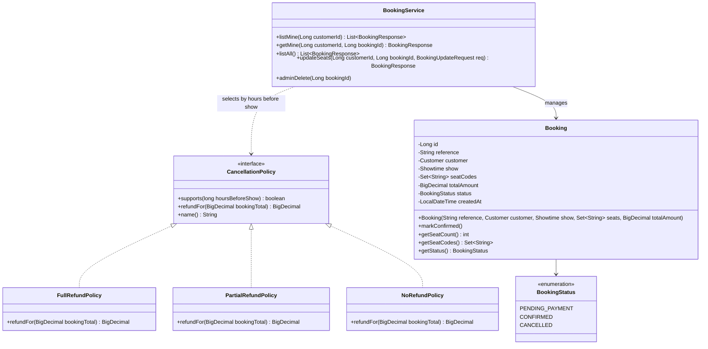
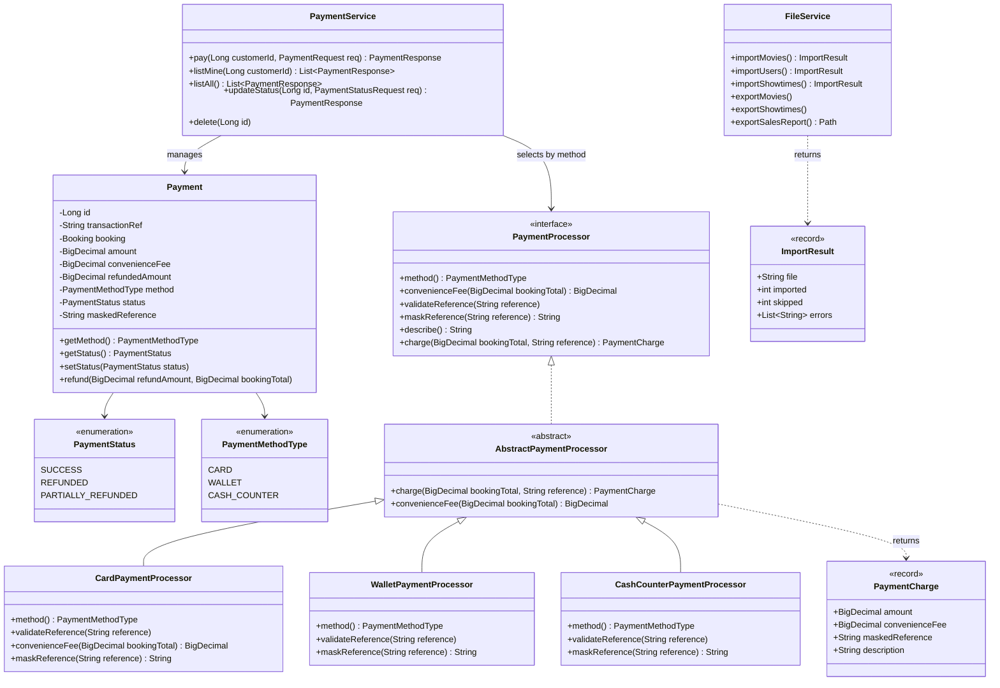
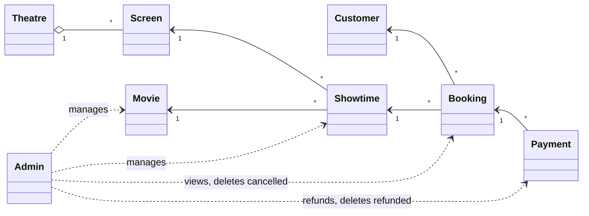

# Class Diagrams – CineMax Movie Ticket Booking

These Mermaid diagrams show the domain classes, the inheritance and strategy hierarchies, and how the modules relate. Method names and parameters match the source code. Only the main attributes are shown, and DTOs and controllers are left out for readability.

Render with any Mermaid viewer (GitHub, the VS Code Mermaid extension, or https://mermaid.live).

---

## 1. User & authentication (Member 1)

---

## 2. Movie catalogue (Member 2)

---

## 3. Theatres and screens (Member 3)

---

## 4. Showtime scheduling and pricing (Member 4)

---

## 5. Booking and seats (Member 5)

---

## 6. Payments and file handling (Member 6)

---

## 7. Cross-module relationships (overview)

### Delete rules (enforced by services)

| Parent | Blocked while … |
|---|---|
| Movie | showtimes exist |
| Theatre | screens exist |
| Screen | showtimes exist |
| Showtime | bookings exist |
| Customer | bookings exist |
| Admin | the caller is not SUPER_ADMIN (checked in `AdminService`) |
