# CineMax Movie Ticket Booking – Whole-System Class Diagram

One class diagram for the whole system. Each box groups the classes of one team component (Member 1 to Member 6). The last box holds the extra modules that are not one of the six workload components.

Only the main fields and methods are shown, so the diagram stays readable. The full detail for each component is in [CLASS_DIAGRAM.md](CLASS_DIAGRAM.md). Repositories, controllers and DTOs are left out.

Rendered copies: [CLASS_DIAGRAM_SYSTEM.pdf](CLASS_DIAGRAM_SYSTEM.pdf) and [CLASS_DIAGRAM_SYSTEM.png](CLASS_DIAGRAM_SYSTEM.png).

## Whole system

```mermaid
classDiagram
    direction TB

    namespace M1_UserAuth {
        class User {
            <<abstract>>
            -Long id
            -String fullName
            -String email
            -String passwordHash
            +getRole()* UserRole
        }
        class Customer {
            -int loyaltyPoints
            +addLoyaltyPoints(int points)
        }
        class Admin {
            -String permissionLevel
        }
        class UserRole {
            <<enumeration>>
            CUSTOMER
            ADMIN
        }
        class AuthStrategy {
            <<interface>>
            +supportedRole() UserRole
            +authenticate(String email, String rawPassword) User
        }
        class AbstractAuthStrategy {
            <<abstract>>
            #findByEmail(String email)* User
        }
        class CustomerAuthStrategy
        class AdminAuthStrategy
        class AuthService {
            +loginCustomer(String email, String password) User
            +loginAdmin(String email, String password) User
        }
        class LoginAttempt {
            -String emailHash
            -int failures
            -LocalDateTime lockedUntil
            +recordFailure(LocalDateTime now, Duration window, Duration lock, int maxFailures)
        }
        class CustomerService {
            +register(RegisterCustomerRequest req) UserResponse
            +updateProfile(Long id, CustomerUpdateRequest req) UserResponse
            +delete(Long id)
        }
        class AdminService {
            +createAdmin(CreateAdminRequest req) UserResponse
            +updatePermission(Long actorId, Long id, UpdateAdminRequest req) UserResponse
            +deleteAdmin(Long actorId, Long id)
        }
    }

    namespace M2_MovieCatalogue {
        class Movie {
            <<abstract>>
            -Long id
            -String title
            -String genre
            -Integer durationMinutes
            -LocalDate releaseDate
            +getFormat()* String
            +getSurcharge()* BigDecimal
        }
        class StandardMovie
        class ImaxMovie
        class ThreeDMovie
        class MovieFactory {
            <<factory>>
            +create(String format) Movie
        }
        class MovieService {
            +search(String title, String genre) List~MovieResponse~
            +create(MovieRequest req) MovieResponse
            +update(Long id, MovieRequest req) MovieResponse
            +delete(Long id)
        }
    }

    namespace M3_TheatreScreen {
        class Theatre {
            -Long id
            -String name
            -String city
        }
        class Screen {
            <<abstract>>
            -Integer rowCount
            -Integer seatsPerRow
            +getScreenType()* String
            +getPriceMultiplier()* BigDecimal
            +isValidSeat(String seatCode) boolean
            +getTotalSeats() int
        }
        class StandardScreen
        class PremiumScreen
        class VipScreen
        class ScreenFactory {
            <<factory>>
            +create(String screenType) Screen
        }
        class TheatreService {
            +list() List~TheatreResponse~
            +update(Long id, TheatreRequest req) TheatreResponse
            +delete(Long id)
        }
        class ScreenService {
            +list(Long theatreId) List~ScreenResponse~
            +create(ScreenRequest req) ScreenResponse
            +update(Long id, ScreenRequest req) ScreenResponse
            +delete(Long id)
        }
    }

    namespace M4_ShowtimeScheduling {
        class Showtime {
            -Long id
            -LocalDateTime startTime
            -BigDecimal basePrice
            +getMovie() Movie
        }
        class PricingStrategy {
            <<interface>>
            +supports(LocalDateTime showTime) boolean
            +priceFor(BigDecimal basePrice, LocalDateTime showTime) BigDecimal
            +priority() int
        }
        class WeekdayPricingStrategy
        class WeekendPricingStrategy
        class MatineePricingStrategy
        class ShowService {
            +create(ShowRequest req) ShowResponse
            +update(Long id, ShowRequest req) ShowResponse
            +delete(Long id)
        }
    }

    namespace M5_BookingSeats {
        class Booking {
            -Long id
            -String reference
            -Set~String~ seatCodes
            -BigDecimal totalAmount
            -BookingStatus status
            +getSeatCount() int
            +markConfirmed()
        }
        class BookingStatus {
            <<enumeration>>
            PENDING_PAYMENT
            CONFIRMED
            CANCELLED
        }
        class CancellationPolicy {
            <<interface>>
            +supports(long hoursBeforeShow) boolean
            +refundFor(BigDecimal bookingTotal) BigDecimal
        }
        class FullRefundPolicy
        class PartialRefundPolicy
        class NoRefundPolicy
        class BookingService {
            +listMine(Long customerId) List~BookingResponse~
            +updateSeats(Long customerId, Long bookingId, BookingUpdateRequest req) BookingResponse
            +cancel(Long customerId, Long bookingId) CancellationResult
            +adminDelete(Long bookingId)
        }
    }

    namespace M6_PaymentFiles {
        class Payment {
            -Long id
            -String transactionRef
            -BigDecimal amount
            -BigDecimal convenienceFee
            -BigDecimal refundedAmount
            -PaymentStatus status
            +refund(BigDecimal refundAmount, BigDecimal bookingTotal)
        }
        class PaymentStatus {
            <<enumeration>>
            SUCCESS
            REFUNDED
            PARTIALLY_REFUNDED
        }
        class PaymentMethodType {
            <<enumeration>>
            CARD
            WALLET
            CASH_COUNTER
        }
        class PaymentProcessor {
            <<interface>>
            +method() PaymentMethodType
            +validateReference(String reference)
            +charge(BigDecimal bookingTotal, String reference) PaymentCharge
        }
        class AbstractPaymentProcessor {
            <<abstract>>
            +charge(BigDecimal bookingTotal, String reference) PaymentCharge
        }
        class CardPaymentProcessor {
            +convenienceFee(BigDecimal bookingTotal) BigDecimal
        }
        class WalletPaymentProcessor
        class CashCounterPaymentProcessor
        class PaymentService {
            +pay(Long customerId, PaymentRequest req) PaymentResponse
            +listMine(Long customerId) List~PaymentResponse~
            +updateStatus(Long id, PaymentStatusRequest req) PaymentResponse
            +delete(Long id)
        }
        class FileService {
            +importMovies() ImportResult
            +importUsers() ImportResult
            +importShowtimes() ImportResult
            +exportMovies()
            +exportShowtimes()
            +exportSalesReport() Path
        }
    }

    namespace Extra_NotificationsReviewsTicketsReports {
        class Notification {
            -Long id
            -NotificationType type
            -String message
            -LocalDateTime readAt
            +markRead()
        }
        class NotificationService {
            +inbox(Long customerId) NotificationInbox
            +notifyBookingConfirmed(Booking booking)
            +notifyBookingCancelled(Booking booking, BigDecimal refund)
            +runReminderSweep()
        }
        class EmailSender {
            <<interface>>
        }
        class OutboxEmailSender
        class SmtpEmailSender
        class Review {
            -Long id
            -int rating
            -String comment
            -Long bookingId
        }
        class ReviewService {
            +forMovie(Long movieId) MovieReviews
            +create(Long customerId, ReviewRequest request) ReviewResponse
        }
        class TicketService {
            +ticketPdf(Long customerId, Long bookingId) byte[]
            +qrPng(Long customerId, Long bookingId) byte[]
        }
        class ReportService {
            +sales(LocalDate from, LocalDate to) SalesReport
            +salesCsv(LocalDate from, LocalDate to) String
        }
    }

    %% Member 1
    User <|-- Customer
    User <|-- Admin
    User ..> UserRole
    AuthStrategy <|.. AbstractAuthStrategy
    AbstractAuthStrategy <|-- CustomerAuthStrategy
    AbstractAuthStrategy <|-- AdminAuthStrategy
    AuthService --> AuthStrategy : uses
    AuthService ..> LoginAttempt : throttles
    CustomerService ..> Customer : manages
    AdminService ..> Admin : manages

    %% Member 2
    Movie <|-- StandardMovie
    Movie <|-- ImaxMovie
    Movie <|-- ThreeDMovie
    MovieFactory ..> Movie : creates
    MovieService --> MovieFactory : uses
    MovieService ..> Movie : manages

    %% Member 3
    Theatre "1" o-- "*" Screen : has
    Screen <|-- StandardScreen
    Screen <|-- PremiumScreen
    Screen <|-- VipScreen
    ScreenFactory ..> Screen : creates
    ScreenService --> ScreenFactory : uses
    TheatreService ..> Theatre : manages

    %% Member 4
    Showtime --> Movie
    Showtime --> Screen
    PricingStrategy <|.. WeekdayPricingStrategy
    PricingStrategy <|.. WeekendPricingStrategy
    PricingStrategy <|.. MatineePricingStrategy
    Showtime ..> PricingStrategy : priced by highest priority
    ShowService ..> Showtime : manages

    %% Member 5
    Booking --> BookingStatus
    Booking "*" --> "1" Showtime : for show
    CancellationPolicy <|.. FullRefundPolicy
    CancellationPolicy <|.. PartialRefundPolicy
    CancellationPolicy <|.. NoRefundPolicy
    BookingService ..> CancellationPolicy : selects by hours before show
    BookingService ..> Booking : manages
    Customer "1" <-- "*" Booking : makes

    %% Member 6
    Payment "*" --> "1" Booking : pays for
    Payment --> PaymentStatus
    Payment --> PaymentMethodType
    PaymentProcessor <|.. AbstractPaymentProcessor
    AbstractPaymentProcessor <|-- CardPaymentProcessor
    AbstractPaymentProcessor <|-- WalletPaymentProcessor
    AbstractPaymentProcessor <|-- CashCounterPaymentProcessor
    PaymentService --> PaymentProcessor : selects by method
    PaymentService ..> Payment : manages
    FileService ..> Movie : reads and writes seed file
    FileService ..> Showtime : reads and writes seed file

    %% Extra modules
    NotificationService ..> Notification : creates
    NotificationService --> EmailSender : sends via
    EmailSender <|.. OutboxEmailSender
    EmailSender <|.. SmtpEmailSender
    Notification "*" --> "1" Customer : for
    BookingService ..> NotificationService : notifies
    Review "*" --> "1" Movie : about
    Review "*" --> "1" Customer : written by
    ReviewService ..> Review : manages
    TicketService --> BookingService : reads paid bookings
    ReportService ..> Payment : totals, excludes cancelled
    ReportService ..> Showtime : occupancy
```

## Reading the diagram

- **Solid arrow with hollow triangle** (`<|--`, `<|..`): inheritance or interface implementation.
- **Dashed arrow** (`..>`): uses or creates, with no field stored.
- **Solid arrow** (`-->`): holds a reference.
- **Diamond** (`o--`): a theatre has screens.
- **Factory** (`MovieFactory`, `ScreenFactory`): picks the right subclass from a code.
- **Strategy and template method**: `PricingStrategy`, `CancellationPolicy`, `PaymentProcessor` and `AbstractPaymentProcessor` allow a new rule to be added as one class.

Repositories, controllers, DTOs and exceptions are not shown, to keep the diagram readable. The extra box is not one of the six workload components.
