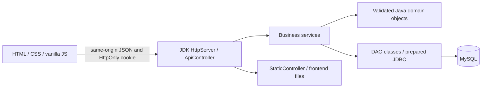

# Architecture and OOP explanation

The Java server serves both browser assets and APIs. GET routes fetch data; POST routes change state. ApiController translates HTTP requests and errors. Services own rules such as friendship, membership, roles and moderation. DAOs own SQL. Jdbc supplies small shared helpers for parameter binding, resource cleanup, row mapping, generated IDs and transactions. DAOs use simple maps for response projections, while models represent values/behavior that business rules use.

Transactions commit a mutation and its activity event together. Database constraints guard against concurrent duplicate friendships/memberships/conversations. Friendship is derived from an ACCEPTED request; there is no redundant friendships table. Removing a friendship deletes that accepted request. A REJECTED request remains to prevent repeated unsolicited requests.

## Role inheritance

User validates identity and owns a QuestionnaireResponse association. Member adds group-creation capability. CommunityLeader inherits Member and adds assigned-community moderation behavior. Admin extends User independently because it has different permissions. AuthService creates the proper runtime subclass from the role record; dashboard routing calls the overridden method. Current role and suspension are loaded at every authenticated request.

## Runtime polymorphism used by real chat

Conversation owns ID, creator ID and an immutable list of Member participants. Its abstract `getDisplayName(viewerId)` has two implementations:

- PrivateConversation finds the other participant's full name.
- GroupConversation returns its stored group name.

MessageDAO builds the appropriate subclass from the conversation type. MessageService iterates a list, assigns each object to the **Conversation** base type, and calls **the same method** to supply `display_name` to the frontend. This keeps the conversation list independent of how each kind chooses its title. It is runtime polymorphism exercised by the application, rather than a disconnected classroom example.

## Interfaces

Post implements Approvable for pending → approved/rejected transitions. Model transitions prevent self-moderation and repeated moderation; PostService additionally verifies actual role, assignment and active community, then saves through PostDAO.

DailyReport implements Reportable. ReportService invokes `generateReport()` through the Reportable type. The interface defines the reporting contract, while DailyReport owns date-specific aggregation and returns data without message content.

## Overloading and encapsulation

Member has a basic registration constructor and an ID-bearing persisted constructor. Post similarly distinguishes draft construction from reconstruction of a saved record. UserDAO overloads `searchUsers(String)` with `searchUsers(String,String)` so an administrator's search can optionally filter passionate interests; the API exposes this via `interest`.

All model attributes are private. User offers validated setters where profile identity is mutable. QuestionnaireResponse and Conversation expose immutable collection snapshots, preventing callers from silently changing saved answers or participants. Constants such as matching weights are static final; persistence is never replaced with static counters.

## Matching calculation

Interest enthusiasm is `rating - 1`. Weighted Jaccard is `sum(min(a,b)) / sum(max(a,b))`, earning up to 50 points. Two people who dislike everything earn zero interest points. Experience differences of 0/1/2 levels earn 15/7.5/0 points. Goal Jaccard earns up to 20. Equal collaboration preferences earn 10; Both paired with one specific preference earns 7.5; opposite preferences earn 0. Activity differences of 0/1/2 earn 5/2.5/0. The total is rounded and clamped to 0–100.

Candidates exclude self, admins, suspended users, incomplete questionnaires, existing friends and pending requests. Community fit is the related interest's rating multiplied by 20; unmatched custom communities receive the baseline 20. Both lists sort descending by their respective score.

## Session and rendering boundary

Sessions contain a random 256-bit token, user ID and eight-hour expiry in a ConcurrentHashMap. The browser receives an HttpOnly SameSite=Strict cookie. Logout revokes it. Same-origin JSON POSTs and Origin checks protect against obvious cross-site writes. The localhost demo uses HTTP; sessions are not durable across restarts.

The frontend only uses escaped HTML for dynamic text; form value attributes are also escaped. It never inserts unescaped post/comment/message content. Static assets use a restrictive content security policy. Role checks in the UI improve navigation but the backend independently checks every protected action.

## Deliberate simplicity

No dependency injection container, ORM, router framework, AI or WebSockets. Chat polls every four seconds, stops fetching while the document is hidden, and loads the latest 200 messages. SQL timestamps/report sessions use UTC. The application is designed for a small local academic demonstration, not large-scale production traffic.
