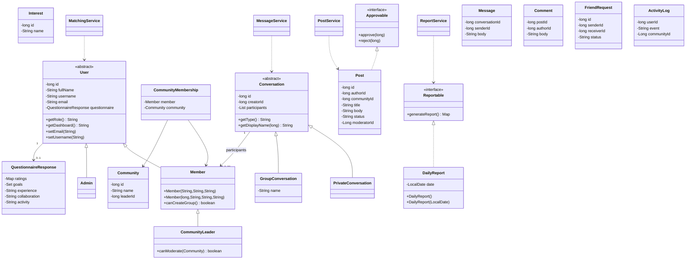

# Class diagram

This diagram reflects Java inheritance, interfaces, and object references. Persistence relationships represented by IDs are listed separately below.

Persistent associations use foreign-key IDs rather than loading an entire object graph: User ↔ Interest via user_interests; User ↔ FriendRequest ↔ User; Community ↔ Post; Post ↔ Comment; Conversation ↔ Message; Conversation ↔ User via conversation_members; ActivityLog ↔ actor and optional community. See the database ER diagram for cardinalities.

Constructor overloading is visible in Member/Post/DailyReport. Method overloading is in UserDAO's two searchUsers signatures. Conversation title selection is exercised through a base-class reference in MessageService, making it a concise live demonstration of runtime dispatch.
