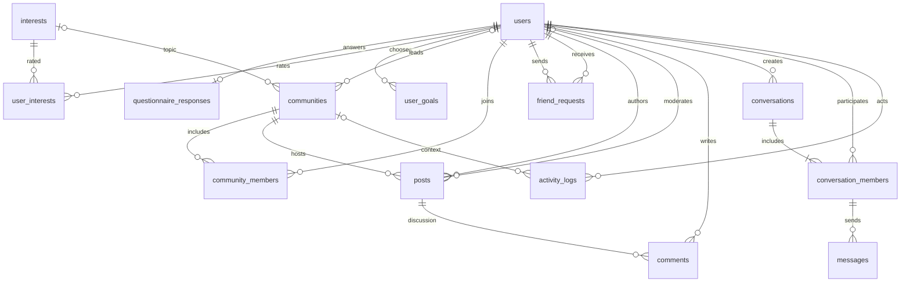

# Database design

MySQL uses utf8mb4 and case-insensitive username/email uniqueness. All tables use primary keys and relational foreign keys. No comma-separated IDs are stored. Schema creation is idempotent but is not a migration system for older changed schemas.

| Table | Purpose and key constraints |
|---|---|
| users | Unique username/email, salted password hash, role, suspension, profile |
| interests | Topic records, unique names |
| questionnaire_responses | One response per user, controlled preference values |
| user_interests | Composite user/interest PK, rating CHECK 1–5 |
| user_goals | Composite user/goal PK, enumerated goal values |
| communities | Optional related interest, assigned leader FK, active flag, unique name |
| community_members | Composite user/community PK and joined timestamp |
| friend_requests | Sender/receiver FKs, state, self-request CHECK, unique unordered pair |
| posts | Community/author FKs, moderation state, moderator and timestamp |
| comments | Post/author FKs and body |
| conversations | Private/group type, creator, unique private pair, type/pair CHECK |
| conversation_members | Composite conversation/user PK |
| messages | Composite conversation/sender FK ensures sender is a participant |
| activity_logs | Actor, event, optional community, timestamp; no password/message body |

## Friendship representation

`pair_low = LEAST(sender_id,receiver_id)` and `pair_high = GREATEST(...)` are stored generated columns with one unique pair index. This prevents duplicate/reversed requests even under concurrent submissions. An ACCEPTED request is the friendship; removal deletes it. Rejection remains as a historical block on repeated requests. The UI shows only pending incoming/outgoing requests and accepted friendships.

## Conversation representation

Private conversations use ordered non-null participant IDs and a unique pair. Groups have null pair columns, allowing multiple groups. Initial membership is inserted transactionally with the conversation. Message insertion references a composite membership foreign key; the service also checks membership before reads/writes. Friends are required for private sends and initial group invitations. Existing history remains visible to its participants after friendship removal.

## Moderation and reporting

Posts start PENDING. Only APPROVED rows from active communities appear in feeds. Assignment, membership, self-moderation and state-transition rules live in Java services because they involve multiple records. Administrator suspension/archive preserves historical records instead of deleting referential data.

Mutations and activity logs commit together. Reports aggregate event counts and most-active actors/communities within UTC `[date 00:00, next-date 00:00)` boundaries. Deactivation counts refer to admin actions on the date, not the current number of suspended accounts. New friendship counts measure accept actions even if the friendship is removed later. Seed examples do not fabricate activity events.

## Execution evidence

schema.sql and seed.sql execute against isolated MySQL 8.4.9. Repeating the seed retains nine users, ten communities, eighty interest ratings, three posts, one comment, one friendship, one private conversation and two messages. JDBC DAO execution still requires Connector/J; see testing.md.
